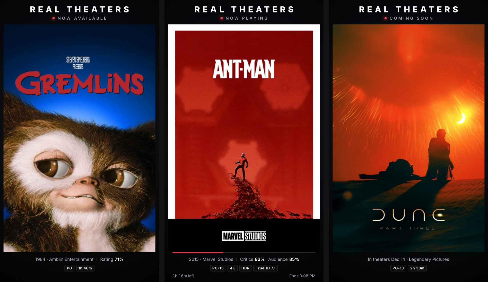
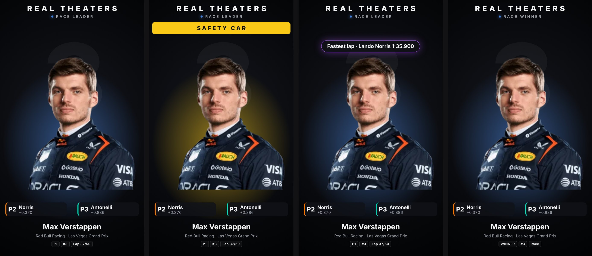

# Marquee

Yup, it's vibe coded, deal with it. 

I have a tv operating as a digital movie poster in my theater.  It was running Posterr but I have having a lot of issues with it flickering and updating constantly so I went looking for a solution, which I didn't quite find.  I fired up Claude and this is what we came up with. 

It's a small Docker container that I run in Unraid that ties into Plex and displays movie posters on any TV with a web browser. I run it on a 42" Google TV running Fully Kiosk Browser.



## How it operates

- **When nothing is playing,** it slowly cycles through posters from your Plex movie library, with the year, studio, rating and scores underneath.
- **When a movies is started,** it switches to that poster with a progress bar, how much time is left and what time it ends, along with movie information 4K, HDR or Dolby TrueHD.
- **I didn't care for the poster to be lit while watching a movie, I find it distracting. When a movie plays,** the screen fades to black, it does not turn off. You may find that distracting as well, if you have some automation in your home you could likely have it automatically fully turn off. 
- **It pulls in Coming Soon from Radar for movies not yet released.  I didn't want past released movies in the queue to be included as there is no quartentee they will show up. 
- **If you have your own posters or family photos,** you can drop them in a folder and they'll show up in the rotation as we;;.

### And for race weekends

We are big F1 Fans, so Marquee can also hook into F1 integration in Home Assistant. During a race it shows who's leading with their team colours, who's in 2nd and 3rd and how far back they are, a banner when the safety car comes out, a pop-up for pit stops and fastest laps, and the winner once it's over. During race week it adds a countdown to the next race and the championship standings in the poster rotation.  It works when watching race replays but Home Assistant is required for that.




## A few things I cared about

- **No flicker.** Each new poster is fully loaded before it fades in, and the screen only changes when it actually needs to.
- **Light on the server.** It's a single small Node.js program with nothing extra to install, and it checks Plex every few seconds.
- **Your passwords stay put.** The Plex, Radarr and Home Assistant keys live in the container. The TV's browser never sees them.
- **Easy to tweak.** Headings, the theater name across the top, how often things rotate, what ratings or genres to skip at certain hours: all of it in in the Unraid template.

## Install on Unraid

1. Open the Unraid terminal and download the code:
   ```sh
   mkdir -p /mnt/user/appdata/marquee && cd /mnt/user/appdata/marquee
   git clone https://github.com/SeveredDime/marquee.git
   cd marquee && docker build -t marquee:latest .
   ```
2. Copy the template so it shows up in Unraid:
   ```sh
   cp unraid/my-marquee.xml /boot/config/plugins/dockerMan/templates-user/my-marquee.xml
   ```
3. In Unraid go to **Docker > Add Container**, pick **marquee** from the template list, fill in your Plex address and Plex token, and click **Apply**.
4. On the TV, open `http://<unraid-ip>:8686`.

To update later: `cd /mnt/user/appdata/marquee/marquee && git pull && docker build -t marquee:latest .`, then restart the container from the Docker tab.

## Install with Docker anywhere else

```sh
git clone https://github.com/SeveredDime/marquee.git && cd marquee
docker build -t marquee:latest .
docker run -d --name marquee -p 8686:8686 \
  -e PLEX_URL=http://192.168.1.100:32400 \
  -e PLEX_TOKEN=your-plex-token \
  -e TZ=America/New_York \
  --restart unless-stopped marquee:latest
```

Add `-v /path/to/posters:/posters:ro` for your own images and `-v /path/to/movies:/movies:ro` for local trailer files.

## Optional extras

- **Coming Soon and trailers:** set `RADARR_URL` and `RADARR_API_KEY`.
- **Formula 1 screens:** see [docs/home-assistant-f1.md](docs/home-assistant-f1.md).
- **Sideways TV:** set `ROTATE` to `90`, `180` or `270` if your TV is mounted on its side but the player only outputs landscape.

## All settings

Every setting is an environment variable (a field in the Unraid template).

| Variable | Default | Meaning |
|---|---|---|
| `PLEX_URL` | `http://localhost:32400` | Your Plex server |
| `PLEX_TOKEN` | (required) | Plex token |
| `LIBRARIES` | all movie libraries | Comma-separated library names for idle posters |
| `SLIDE_SECONDS` | `30` | Seconds per idle poster |
| `THEATER_PLAYERS` | (none) | Comma-separated player names that trigger the black screen, e.g. `SHIELD` |
| `THEATER_MODE` | `black` | `black` = fade to black for theater playback, `poster` = show it like any other stream |
| `HIDE_USER` | `true` | Hide who is watching. Set to `false` to show "Watching: name" under the progress bar |
| `USER_NAMES` | (none) | Friendly names for Plex users, e.g. `jsmith=John, kidsaccount=The Kids`. Matched on Plex user name or user id, not case-sensitive. Users not listed show their Plex name. The container log prints each Plex user name the first time it is seen |
| `HIDE_PLAYER` | `true` | Hide the player/device name next to the viewer |
| `POLL_SECONDS` | `5` | How often Plex is checked |
| `THEATER_NAME` | *(blank)* | Your theater's name, shown large across the top (e.g. `My Home Theater`). The mode line (Now Available, Now Playing, Coming Soon, Now Previewing, Spotlight) moves underneath in smaller type. Blank keeps the original header. |
| `ROTATE` | `0` | Turn the whole display for a sideways-mounted TV whose player only outputs landscape: `270` (counter-clockwise), `90` (clockwise) or `180`. Add `?rotate=` to the page URL to try a value without restarting. |
| `HEADING_LIBRARY` | `Now Available` | Heading over posters from your Plex library |
| `HEADING_PLAYING` | `Now Playing` | Heading while something is playing |
| `HEADING_COMING_SOON` | `Coming Soon` | Heading over Radarr Coming Soon posters |
| `HEADING_TRAILER` | `Now Previewing` | Heading while a trailer plays |
| `HEADING_CUSTOM` | `Spotlight` | Heading over your own posters and photos |
| `HA_URL` | *(blank)* | Home Assistant address, e.g. `http://192.168.1.100:8123` (for the F1 leader) |
| `HA_TOKEN` | *(blank)* | Home Assistant long-lived access token (Profile > Security). Read-only use. |
| `F1_LEADER` | `true` | While an F1 session is live (HA F1 integration), show the leader's photo in the team colour instead of posters. A theater movie in Plex still wins. |
| `HEADING_F1` | `Race Leader` | Heading for the F1 leader during a race or sprint (other sessions say e.g. `Qualifying leader`) |
| `F1_WINNER_MINUTES` | `15` | After a race or sprint, show the winner with the final podium for this many minutes (0 = off) |
| `F1_CARDS_EVERY` | `8` | During race week, add a countdown card and the driver standings to the slideshow every N posters (0 = off) |
| `HEADING_F1_WINNER` / `HEADING_F1_WEEK` / `HEADING_F1_STANDINGS` | `Race Winner` / `Race Week` / `Championship` | Headings for the winner screen and the race-week cards |
| `F1_LEADER_ENTITY` etc. | `sensor.f1_drivers_top_three_p1` | Entity ids, in case the integration names them differently (`F1_SESSION_ENTITY`, `F1_DRIVERS_ENTITY`, `F1_LAP_ENTITY`) |
| `SHOW_TITLE` | `false` | Show the title as a big line under the poster. Off by default because the poster already shows it, which makes the poster larger. TV episodes still show `S02E04 · Episode name`, and trailers show the title in the small line. |
| `SHOW_SCORES` | `true` | Critic and audience scores (from Plex) under the poster |
| `SHOW_STUDIO` | `true` | Studio next to the year |
| `EXCLUDE_RATINGS` | (none) | Content ratings to leave out of the idle slideshow, e.g. `R,NC-17` |
| `EXCLUDE_RATINGS_HOURS` | (always) | Only apply `EXCLUDE_RATINGS` between these hours, e.g. `07-21` (overnight ranges like `21-07` work) |
| `INCLUDE_GENRES` | (all) | Only show these genres in the idle slideshow, e.g. `Comedy,Animation` |
| `EXCLUDE_GENRES` | (none) | Leave these genres out, e.g. `Horror` |
| `CUSTOM_DIR` | `/posters` | Folder of your own posters/photos (jpg, png, webp, gif). Map a host folder to it |
| `CUSTOM_EVERY` | `4` | Show one of your own images after every N movie posters (0 = off) |
| `CUSTOM_CAPTIONS` | `true` | Use the file name as the caption (`Family_Photo.jpg` -> "Family Photo") |
| `RADARR_URL` | (none) | Radarr address, e.g. `http://192.168.1.100:7878`. Needed for Coming Soon and trailers |
| `RADARR_API_KEY` | (none) | Radarr API key (Radarr > Settings > General) |
| `COMING_SOON_EVERY` | `6` | Show a Coming Soon poster (Radarr movies that are not out yet: theatrical date, or digital date if there is none, in the future) after every N posters (0 = off) |
| `COMING_SOON_DAYS` | `120` | How far ahead to look |
| `TRAILERS_EVERY` | `8` | Play a trailer after every N posters (0 = off) |
| `TRAILER_SOURCE` | `both` | `both` = local file first, then YouTube; `files` or `youtube` only |
| `TRAILER_MAX_SECONDS` | `150` | Longest a trailer plays before moving on |
| `TRAILER_MUTED` | `true` | `false` plays trailers with sound. Fully Kiosk must allow it: Web Content Settings > Autoplay Videos on (and Autoplay Audio, where offered). If the browser still blocks sound the trailer plays silently. Trailers never play while anything is playing in Plex. |
| `TRAILER_VOLUME` | `60` | Trailer volume, 0-100 (only when sound is on) |
| `MOVIES_DIR` | `/movies` | Your movies folder mapped read-only into the container, for local trailer files (`*-trailer.mp4` or a `Trailers` sub-folder) |

## Credits

Built by SeveredDime with help from Claude. F1 data comes from the [F1 Sensor](https://github.com/Nicxe/f1_sensor) Home Assistant integration. Marquee is a hobby project and is not affiliated with Plex, Radarr, Formula 1 or Home Assistant.
